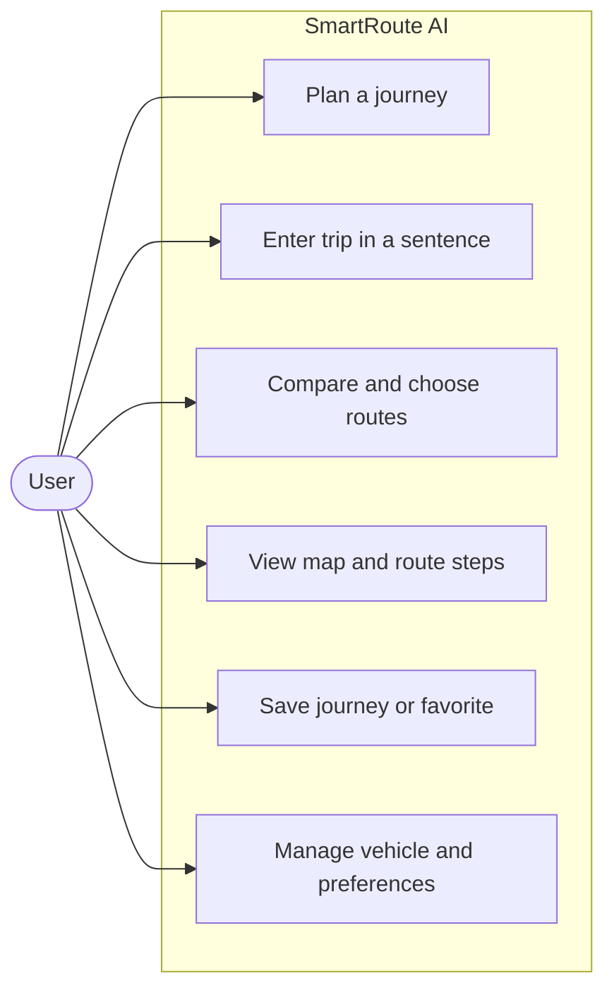
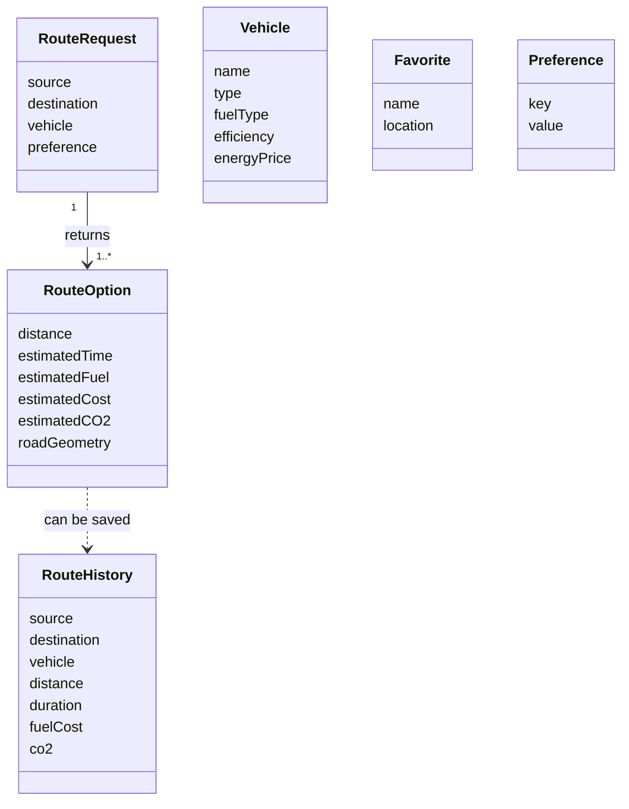
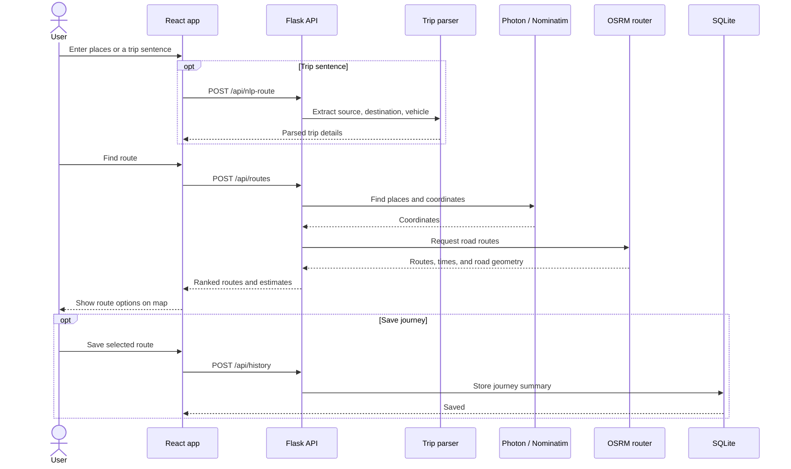
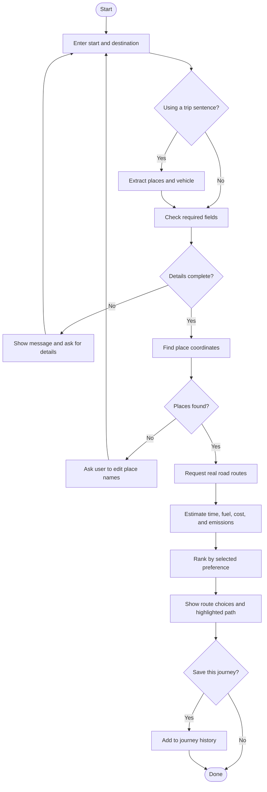

# SmartRoute AI

A compact full-stack route planner for an internship project. React provides the interface and interactive map; Flask handles natural-language trip parsing, geocoding, route comparison, estimates, and SQLite persistence.

## Project layout

```text
frontend/       React, Vite, and Leaflet app
backend/        Flask API and route services
database/       SQLite database created automatically at runtime
README.md
```

## Run locally

Requirements: Python 3.10+ and Node.js 18+.

### Backend

```powershell
cd backend
python -m venv .venv
.\.venv\Scripts\Activate.ps1
pip install -r requirements.txt
python app.py
```

The API listens at `http://localhost:5000`. SQLite is created at `database/smartroute.db` on first run. Optional settings: `PORT`, `FRONTEND_ORIGIN` (comma-separated allowed origins), and `FLASK_DEBUG=1` for local development only.

### Frontend

In another terminal:

```powershell
cd frontend
npm install
npm run dev
```

Open the local Vite URL, usually `http://localhost:5173`. Set `VITE_API_URL` if the API is hosted at a different URL.

## Features

- Manual or natural-language trip input. Examples: “From MVP Colony to RK Beach”, “Take me from MVP Colony to RK Beach by bike”, “I want to travel from Vizag station to RK Beach by car”.
- OpenStreetMap place suggestions via Photon (including local colleges, cafés, and named venues), final location geocoding via Nominatim, and OSRM route alternatives.
- Route Copilot chat that fetches real route comparisons for a trip or answers questions about the current route. It uses the app's rule-based trip parser and live route API; it is not a hosted generative AI model.
- Browser voice input for trip descriptions and GPS-triggered spoken route instructions when location permission is available.
- Fastest, shortest, cheapest, eco, and balanced route ranking. Balanced scoring normalizes time, distance, cost, and estimated emissions across routes returned for the journey.
- Interactive Leaflet map, route selection, vehicle profiles, saved places, journey history, and theme preference.
- Responsive layout and friendly API errors.

## API

| Method | Path | Purpose |
|---|---|---|
| GET | `/api/health` | API status |
| POST | `/api/nlp-route` | Parse `{ "text": "..." }` |
| GET | `/api/search?q=CMR` | Suggest nearby OSM places through Photon |
| POST | `/api/geocode` | Geocode `{ "location": "..." }` |
| POST | `/api/routes` | Route and analyze `{ "source": "...", "destination": "...", "vehicle": "car", "mode": "balanced" }` |
| POST | `/api/chat` | Ask the Route Copilot for a trip or current-route details |
| GET/POST | `/api/history` | List or save a completed journey |
| GET/POST, DELETE | `/api/favorites` | List, create, or remove a favorite |
| GET/POST, DELETE | `/api/vehicles` | List, create, or remove a vehicle profile |
| GET/PUT | `/api/preferences` | Read or save simple preferences |

## Estimates and limits

Fuel or energy used is route distance divided by the selected vehicle efficiency. Cost multiplies consumption by the vehicle's configurable price. Combustion emissions multiply fuel by an approximate factor (petrol 2.31 kg CO₂/L, diesel 2.68 kg CO₂/L); EV operational emissions use the configured kg CO₂/kWh factor and default to zero when no factor is configured. These are estimates, not measured consumption or lifecycle emissions.

OSRM's public demo service does not provide live traffic, and route alternatives may be limited or absent for a particular trip. The public OSRM endpoint used here supplies driving routes; walking and cycling need a different provider. The displayed ETA uses the OSRM duration as a baseline, a typical vehicle-specific average speed (lower for local trips), and a small delay for turns. These are estimates, not live traffic predictions. Nominatim and OSRM public endpoints have fair-use limits; this demo geocodes only when a route is requested. For a public deployment, use hosted services with appropriate capacity and attribution.

## Future work

Authentication and per-user records, richer vehicle editing, live fuel prices, transit routing, multi-stop journeys, EV charging stations, and a traffic-enabled routing provider.

## System diagrams

These diagrams show the main features and data flow. They use Mermaid and render in Markdown viewers that support Mermaid.

### Use case



### Class diagram



`RouteRequest` and `RouteOption` describe data used while planning; the remaining classes are persisted in SQLite. This demo does not have user accounts, so saved records are not linked to a `User` class.

### Sequence diagram



### Activity diagram


